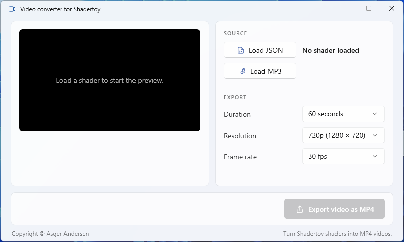
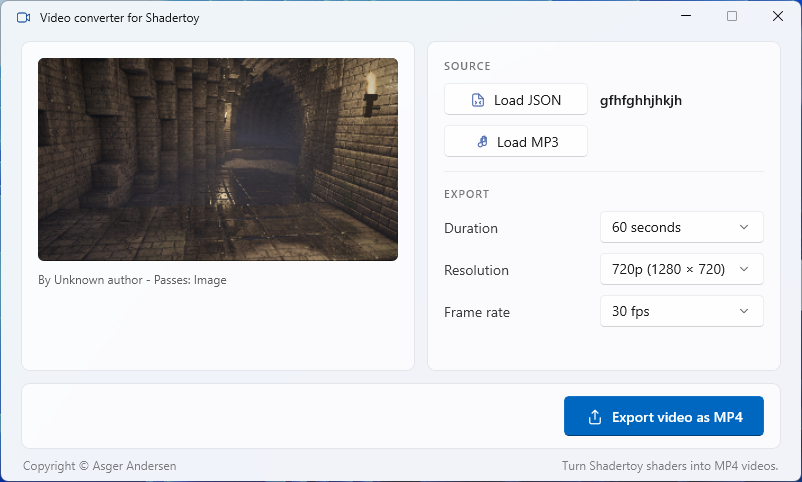
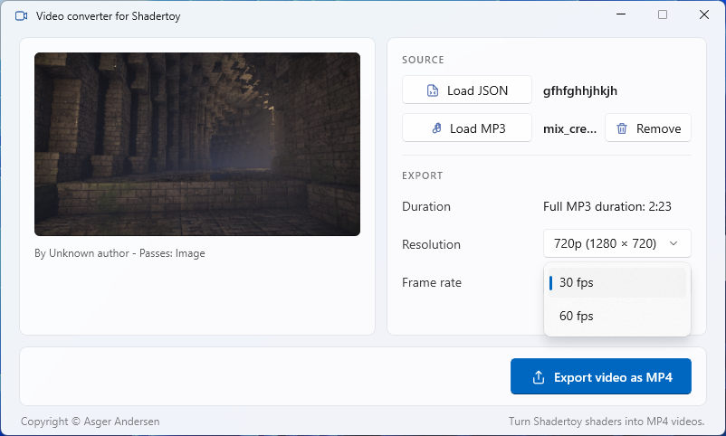
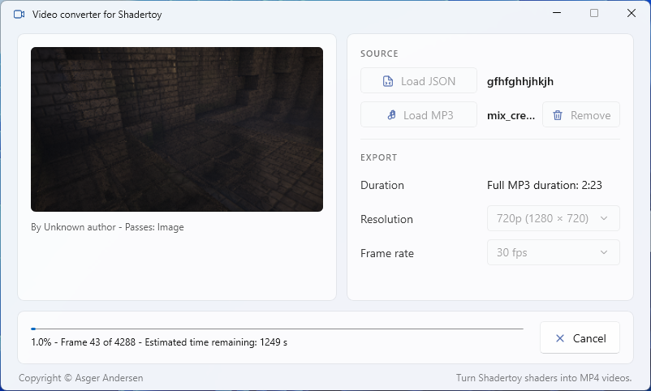

# Video converter for Shadertoy

Copyright (C) Asger Andersen

Video converter for Shadertoy converts exported Shadertoy JSON projects and optional MP3 audio into H.264 MP4 video on Windows x64.

## Screenshots

| Start screen | Shader preview |
|---|---|
|  |  |

| Audio and export options | Export progress |
|---|---|
|  |  |

## Requirements

- Windows 10 1809 or newer, or Windows 11
- Windows x64
- Windows Media Foundation
- Visual C++ runtime components included with Windows or the application package

Media Foundation is required for the H.264 encoder. On a Windows N edition, install the Media Feature Pack.

## Installation

Run `VideoConverterForShadertoy-1.0.0-Setup.exe` and follow the installer.

The installer adds shortcuts to the Start menu and optionally to the desktop. To uninstall the application, use Apps and features in Windows or the uninstall shortcut in the Start menu.

## Use

1. Start Video converter for Shadertoy.
2. Select `Load JSON` and open an exported Shadertoy JSON project.
3. Optionally select `Load MP3` and choose an MP3 file.
4. Choose the duration, resolution and frame rate.
5. Select `Export video`.
6. Choose the destination MP4 file.
7. Wait for the export to finish. Use `Cancel` to stop it and discard the partial file.

After a successful export, use `Open video` to open the MP4 in the default player or `Open folder` to show the file in File Explorer.

## Export options

| Option | Values |
|---|---|
| Duration | 60, 90 or 120 seconds |
| Resolution | 720p at 1280 x 720 or 1080p at 1920 x 1080 |
| Frame rate | 30 or 60 fps |
| Audio | Optional MP3, encoded as AAC |
| Output | MP4 with H.264 video |

When an MP3 is loaded, its duration determines the exported video duration.

## Supported Shadertoy features

The application imports Shadertoy JSON projects using `mainImage`. It supports common texture inputs and Buffer A through Buffer D multipass shaders with ping-pong buffers.

## Troubleshooting

If export reports that the H.264 encoder is unavailable, install the Windows Media Feature Pack when applicable and restart Windows.

If preview rendering fails, verify that the selected JSON contains a valid GLSL shader and that texture paths in the project are accessible.

If no MP4 is created, verify write permission for the destination folder and enough free disk space.

If the application does not start, verify that the Windows App SDK runtime files shipped with the installation were not removed or modified.

## Licenses

FFmpeg is used through statically linked LGPL-licensed libraries. The LGPL license texts and FFmpeg notice are installed in the `licenses` folder next to the executable.
